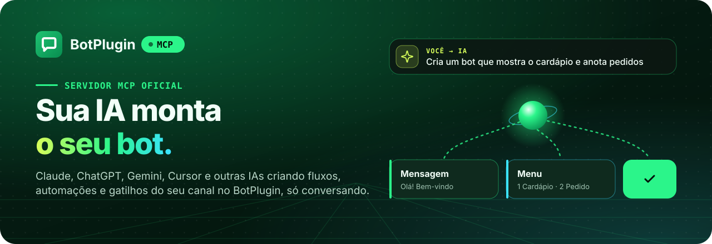
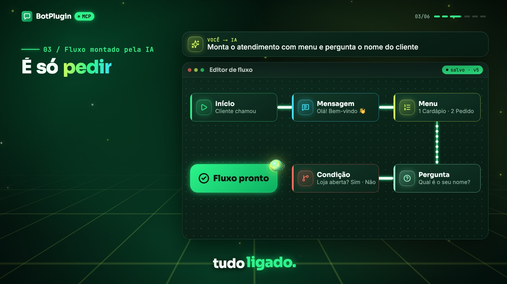
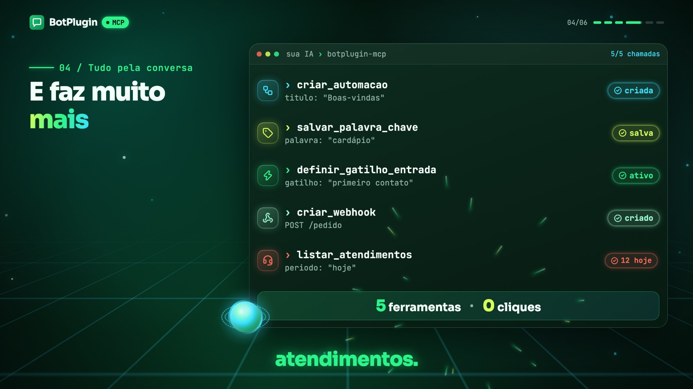
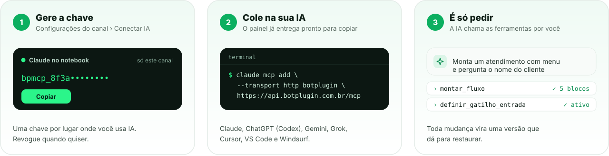

<p align="center">
  <a href="https://botplugin.com.br">
    
  </a>
</p>

<p align="center">
  <a href="#como-conectar"></a>
  <a href="docs/ferramentas.md"></a>
  <a href="#tipos-de-chave"></a>
  <a href="README.en.md"></a>
</p>

<p align="center">
  <a href="#o-que-a-sua-ia-consegue-fazer"><b>O que dá para fazer</b></a> ·
  <a href="#como-conectar"><b>Como conectar</b></a> ·
  <a href="#guia-por-ia"><b>Guia por IA</b></a> ·
  <a href="#ferramentas"><b>Ferramentas</b></a> ·
  <a href="#segurança"><b>Segurança</b></a> ·
  <a href="README.en.md"><b>English</b></a>
</p>

<br>

O **BotPlugin MCP** liga a sua IA favorita aos seus canais no [BotPlugin](https://botplugin.com.br). Em vez de arrastar blocos no editor, você **pede** e a IA faz: monta o fluxo de atendimento, cria automações, configura palavras-chave, gatilhos e webhooks, e ainda consulta os atendimentos do dia.

Funciona com qualquer cliente compatível com o [Model Context Protocol](https://modelcontextprotocol.io). Não tem nada para instalar: o servidor roda na nuvem do BotPlugin e você só cola o endereço e a sua chave.

<p align="center">
  
</p>

---

## O que a sua IA consegue fazer

<table>
  <tr>
    <td width="50%" valign="top">
      
      <h3>Montar o fluxo inteiro</h3>
      <p>Descreva o atendimento e a IA cria os blocos, liga um no outro e organiza tudo no editor. Mensagens, menus, perguntas, condições, mídias, webhooks e mais.</p>
    </td>
    <td width="50%" valign="top">
      
      <h3>Cuidar do resto pela conversa</h3>
      <p>Automações, palavras-chave, gatilhos de entrada, webhooks, anúncios e a consulta dos atendimentos. Tudo que antes eram vários cliques no painel.</p>
    </td>
  </tr>
</table>

| Área | Exemplos do que pedir |
|---|---|
| **Fluxos** | Montar um fluxo do zero, editar um bloco, trocar o texto de um menu, validar e restaurar versões |
| **Automações** | Criar, renomear, ligar e desligar automações |
| **Gatilhos** | Palavras-chave, primeiro contato, qualquer mensagem recebida, abertura do chat no site, comentários e respostas a stories no Instagram |
| **Integrações** | Webhooks que disparam automações a partir de outro sistema e automações para anúncios click-to-WhatsApp |
| **Atendimentos** | Quem está sendo atendido agora, em qual automação e em qual bloco cada contato parou |
| **Canal** | Ver o status do canal e ligar, desligar ou reiniciar o servidor da Cloud |

> [!TIP]
> Cada mudança que a IA faz no fluxo vira uma **versão**. Não gostou? Peça para a IA restaurar a anterior.

---

## Como conectar

<p align="center">
  
</p>

1. **Gere a chave.** No [painel do BotPlugin](https://app.botplugin.com.br), escolha onde:
   - **Um canal:** abra o canal e vá em **Configurações do canal › Conectar IA**.
   - **Vários canais:** clique no seu nome, no rodapé da barra lateral (no celular, menu ☰ › seu nome), e escolha **Conectar IA (todos os canais)**.

   Clique em **Gerar chave** e copie na hora: ela só aparece uma vez.
2. **Cole na sua IA.** Escolha a sua IA logo abaixo, na mesma tela do painel. Os exemplos já saem com a sua chave preenchida. Se preferir, use os guias abaixo.
3. **Peça.** Abra a conversa e diga o que quer. Veja [exemplos de pedidos](docs/exemplos.md).

Você vai precisar de dois dados:

| | Valor |
|---|---|
| **Endereço do servidor** | `https://api.botplugin.com.br/mcp` |
| **Cabeçalho** | `Authorization: Bearer SUA_CHAVE` |

### Tipos de chave

| | Chave de canal | Chave de todos os canais |
|---|---|---|
| **Onde gerar** | Configurações do canal › Conectar IA | Seu nome › Conectar IA (todos os canais) |
| **Alcance** | Um canal | Todos os seus canais, inclusive os que você ganhar acesso depois, ou só os que você escolher |
| **Validade** | Até você revogar | 30 dias, 90 dias ou 1 ano |
| **Como a IA escolhe o canal** | Não escolhe: é sempre o da chave | Pergunta com `listar_canais` e diz o canal a cada pedido |
| **Bom para** | Dar acesso a um canal só, por exemplo para quem cuida de um cliente | Quem cuida de vários canais e quer pedir mudanças em vários de uma vez |

> [!TIP]
> Com a chave de canal, quem cuida de vários canais conecta uma chave de cada um com um nome diferente (por exemplo `botplugin-pizzaria` e `botplugin-loja`). Com a chave de todos os canais, basta uma conexão, `botplugin`.

---

## Guia por IA

| IA | Onde funciona | Situação |
|---|---|---|
| **Claude** | Claude Code, Claude Desktop |  |
| | claude.ai (navegador) |  |
| **ChatGPT / OpenAI** | Codex (CLI e app), API Responses |  |
| | App do ChatGPT |  |
| **Gemini** | Gemini CLI |  |
| | App do Gemini |  |
| **Grok** | API da xAI |  |
| **Cursor** | Editor |  |
| **VS Code** | GitHub Copilot, modo agente |  |
| **Windsurf** | Editor |  |

Nos exemplos, troque `SUA_CHAVE` pela chave do painel. Os arquivos prontos também estão em [`examples/`](examples).

<details>
<summary><b>Claude Code</b> (terminal, desktop e IDE)</summary>
<br>

Rode no terminal:

```bash
claude mcp add --transport http botplugin https://api.botplugin.com.br/mcp \
  --header "Authorization: Bearer SUA_CHAVE"
```

Depois, dentro do Claude Code, o comando `/mcp` mostra o BotPlugin conectado.

</details>

<details>
<summary><b>Claude Desktop</b></summary>
<br>

Em **Configurações › Desenvolvedor › Editar configuração**, acrescente no `claude_desktop_config.json` e reinicie o app. Precisa do [Node.js](https://nodejs.org) instalado.

```json
{
  "mcpServers": {
    "botplugin": {
      "command": "npx",
      "args": [
        "-y",
        "mcp-remote",
        "https://api.botplugin.com.br/mcp",
        "--header",
        "Authorization:${BOTPLUGIN_AUTH}"
      ],
      "env": { "BOTPLUGIN_AUTH": "Bearer SUA_CHAVE" }
    }
  }
}
```

</details>

<details>
<summary><b>claude.ai</b> (navegador) · beta</summary>
<br>

1. Vá em **Configurações › Conectores › Adicionar conector personalizado**.
2. Preencha o nome (`botplugin`) e a URL `https://api.botplugin.com.br/mcp`.
3. Em **Autenticação**, escolha **Sem login**.
4. Em **Cabeçalhos de requisição**, clique em **Adicionar cabeçalho**, escolha `Authorization`, cole `Bearer SUA_CHAVE` e marque **Obrigatório**.

> [!IMPORTANT]
> Precisa ser **Sem login**. Nas opções com login o claude.ai tenta um OAuth que o BotPlugin ainda não usa e falha com "Não foi possível registrar no serviço de login". Os cabeçalhos de requisição estão em liberação gradual pela Anthropic e, em planos Team e Enterprise, só o administrador adiciona. Se a seção não aparecer, use o Claude Code ou o Claude Desktop.

</details>

<details>
<summary><b>Codex</b> (CLI e app da OpenAI)</summary>
<br>

Deixe a chave numa variável de ambiente (no terminal ou no seu `~/.zshrc` / `~/.bashrc`):

```bash
export BOTPLUGIN_TOKEN="SUA_CHAVE"
```

E acrescente em `~/.codex/config.toml`:

```toml
[mcp_servers.botplugin]
url = "https://api.botplugin.com.br/mcp"
bearer_token_env_var = "BOTPLUGIN_TOKEN"
```

</details>

<details>
<summary><b>API da OpenAI</b> (Responses)</summary>
<br>

```bash
curl https://api.openai.com/v1/responses \
  -H "Content-Type: application/json" \
  -H "Authorization: Bearer $OPENAI_API_KEY" \
  -d '{
    "model": "gpt-5",
    "input": "Liste as automações do meu canal",
    "tools": [{
      "type": "mcp",
      "server_label": "botplugin",
      "server_url": "https://api.botplugin.com.br/mcp",
      "headers": { "Authorization": "Bearer SUA_CHAVE" },
      "require_approval": "never"
    }]
  }'
```

</details>

<details>
<summary><b>Gemini CLI</b></summary>
<br>

```bash
gemini mcp add -s user --transport http \
  --header "Authorization: Bearer SUA_CHAVE" \
  botplugin https://api.botplugin.com.br/mcp
```

Ou acrescente em `~/.gemini/settings.json`:

```json
{
  "mcpServers": {
    "botplugin": {
      "httpUrl": "https://api.botplugin.com.br/mcp",
      "headers": { "Authorization": "Bearer SUA_CHAVE" }
    }
  }
}
```

</details>

<details>
<summary><b>API da xAI</b> (Grok)</summary>
<br>

```bash
curl https://api.x.ai/v1/responses \
  -H "Content-Type: application/json" \
  -H "Authorization: Bearer $XAI_API_KEY" \
  -d '{
    "model": "grok-4.7",
    "input": "Liste as automações do meu canal",
    "tools": [{
      "type": "mcp",
      "server_url": "https://api.botplugin.com.br/mcp",
      "server_label": "botplugin",
      "authorization": "SUA_CHAVE"
    }]
  }'
```

</details>

<details>
<summary><b>Cursor</b></summary>
<br>

Acrescente em `~/.cursor/mcp.json` (vale para todos os projetos) ou em `.cursor/mcp.json` dentro do projeto:

```json
{
  "mcpServers": {
    "botplugin": {
      "url": "https://api.botplugin.com.br/mcp",
      "headers": { "Authorization": "Bearer SUA_CHAVE" }
    }
  }
}
```

</details>

<details>
<summary><b>VS Code</b> (GitHub Copilot, modo agente)</summary>
<br>

Crie `.vscode/mcp.json` no projeto, ou rode **MCP: Open User Configuration** para valer em todos:

```json
{
  "servers": {
    "botplugin": {
      "type": "http",
      "url": "https://api.botplugin.com.br/mcp",
      "headers": { "Authorization": "Bearer SUA_CHAVE" }
    }
  }
}
```

</details>

<details>
<summary><b>Windsurf</b></summary>
<br>

Acrescente em `~/.codeium/windsurf/mcp_config.json` e clique em atualizar em **Manage MCPs**:

```json
{
  "mcpServers": {
    "botplugin": {
      "serverUrl": "https://api.botplugin.com.br/mcp",
      "headers": { "Authorization": "Bearer SUA_CHAVE" }
    }
  }
}
```

</details>

---

## Ferramentas

São 24 ferramentas, mais a `listar_canais` na chave de todos os canais. A IA escolhe sozinha qual usar a cada pedido; você não precisa decorar nenhuma. Os parâmetros de cada uma estão em [docs/ferramentas.md](docs/ferramentas.md).

Com a chave de todos os canais, toda ferramenta recebe também o parâmetro `canal`, e cada resposta termina dizendo em qual canal a IA mexeu.

<table>
  <tr>
    <th align="left">Canal</th>
    <th align="left">Automações</th>
  </tr>
  <tr>
    <td valign="top">

`listar_canais`&nbsp;<sup>leitura</sup>&nbsp;<sup>todos os canais</sup><br>
`ver_canal`&nbsp;<sup>leitura</sup><br>
`servidor_cloud`

  </td>
    <td valign="top">

`listar_automacoes`&nbsp;<sup>leitura</sup><br>
`ver_automacao`&nbsp;<sup>leitura</sup><br>
`criar_automacao`<br>
`atualizar_automacao`<br>
`ativar_desativar_automacao`

  </td>
  </tr>
  <tr>
    <th align="left">Gatilhos e ativações</th>
    <th align="left">Fluxo</th>
  </tr>
  <tr>
    <td valign="top">

`listar_ativacoes`&nbsp;<sup>leitura</sup><br>
`definir_gatilho_entrada`<br>
`remover_gatilho_entrada`<br>
`salvar_palavra_chave`<br>
`remover_palavra_chave`<br>
`criar_webhook`<br>
`atualizar_webhook`<br>
`remover_webhook`<br>
`definir_automacao_do_anuncio`

  </td>
    <td valign="top">

`listar_tipos_de_bloco`&nbsp;<sup>leitura</sup><br>
`ver_fluxo`&nbsp;<sup>leitura</sup><br>
`montar_fluxo`<br>
`editar_fluxo`<br>
`validar_fluxo`&nbsp;<sup>leitura</sup><br>
`listar_versoes_fluxo`&nbsp;<sup>leitura</sup><br>
`restaurar_versao_fluxo`

  </td>
  </tr>
  <tr>
    <th align="left" colspan="2">Atendimentos</th>
  </tr>
  <tr>
    <td valign="top" colspan="2">

`listar_atendimentos`&nbsp;<sup>leitura</sup>

  </td>
  </tr>
</table>

<sub><sup>leitura</sup> a ferramenta só consulta e não muda nada no canal. <sup>todos os canais</sup> só existe na chave de todos os canais.</sub>

### Blocos que a IA sabe usar

Mensagem · Menu · Condição · Switch · Perguntas · Tempo · Aguardar resposta · Webhook (requisição HTTP) · Imagem · Vídeo · Áudio · Documento · Mídia por link · Variável de contato · Aleatório / Sequencial · Dia / Hora · Botões e Lista interativa (WhatsApp Oficial) · ChatGPT e Gemini (resposta única) · Fim · Anotação

O que cada bloco faz e em quais canais funciona: [docs/blocos.md](docs/blocos.md). Agentes de IA, agenda e blocos de integração ainda são configurados pelo painel.

---

## Exemplos de pedidos

```text
Monta um atendimento para a minha pizzaria: dá boas-vindas, mostra um menu com
Cardápio, Fazer pedido e Falar com atendente, e pergunta o nome do cliente.
```

```text
Cria uma palavra-chave "promo" que responde com a promoção da semana.
```

```text
Fora do horário de atendimento (seg a sex, 9h às 18h), avisa que respondemos
no próximo dia útil.
```

```text
Quantos atendimentos tive hoje e em qual bloco cada contato parou?
```

```text
Desfaz a última mudança no fluxo de boas-vindas.
```

Com a chave de todos os canais:

```text
Copia o menu de boas-vindas da Loja Centro para a Loja Norte.
```

```text
Desativa as automações de teste em todos os canais.
```

Mais ideias, separadas por tipo de negócio, em [docs/exemplos.md](docs/exemplos.md).

---

## Segurança

- **A chave só abre o que você liberou.** A chave de canal alcança um canal só. A de todos os canais alcança os canais escolhidos na criação e sempre tem validade.
- **Acesso conferido a cada pedido.** Antes de qualquer leitura ou alteração, o BotPlugin confere se você ainda tem acesso ao canal. Se você sair de um canal ou for removido dele, a IA perde o acesso na hora, com qualquer tipo de chave.
- **Nada de segredo exposto.** Senhas, tokens e chaves guardados nos blocos e nas variáveis voltam como `[oculto]` para a IA. Editar um bloco com `[oculto]` mantém o valor original.
- **Só o resumo da chave fica guardado.** O BotPlugin guarda só o hash; a chave em si aparece uma única vez, na hora de gerar.
- **Revogue quando quiser.** No mesmo lugar do painel, cada chave mostra quem criou, quando e o último uso.
- **Tudo tem volta.** Cada gravação do fluxo vira uma versão (as 10 últimas ficam guardadas), e a IA não grava um fluxo com erro novo.
- **Limites de uso:** 120 chamadas por minuto por chave e bloqueio temporário de quem erra a chave muitas vezes seguidas.

Achou uma vulnerabilidade? Veja [SECURITY.md](SECURITY.md).

---

## Perguntas frequentes

<details>
<summary><b>A IA pode apagar o meu bot?</b></summary>
<br>
A IA só faz o que você pede, e muitos clientes MCP pedem a sua confirmação antes de cada ação. Mesmo assim, toda gravação do fluxo vira uma versão que dá para restaurar, e montar um fluxo por cima de um existente exige um pedido explícito para substituir.
</details>

<details>
<summary><b>Cuido de vários canais. Preciso de uma chave para cada?</b></summary>
<br>
Não. Gere uma chave de todos os canais em <b>seu nome › Conectar IA (todos os canais)</b>. Você escolhe se ela vale para todos os canais, inclusive os novos, ou só para alguns, e por quanto tempo. A IA pergunta quais canais você tem e diz em qual mexeu a cada resposta.
</details>

<details>
<summary><b>Funciona com WhatsApp, Instagram e site?</b></summary>
<br>
Sim. A IA sabe quais blocos funcionam em cada tipo de canal e avisa quando um bloco não serve para o seu (por exemplo, botões do WhatsApp Oficial num canal de site).
</details>

<details>
<summary><b>Por que o app do ChatGPT e o claude.ai ainda não funcionam completos?</b></summary>
<br>
Esses apps pedem login por OAuth, e hoje o BotPlugin autentica por chave. O suporte a OAuth está no plano, veja abaixo.
</details>

---

## Próximos passos

- [ ] Login por OAuth, para o app do ChatGPT e o claude.ai sem configuração manual
- [ ] Agentes de IA e agenda pelo MCP
- [ ] Blocos de integração e sub-fluxos
- [ ] Publicação no MCP Registry oficial ([`server.json`](server.json))

Tem uma ideia? [Abra uma sugestão](../../issues/new/choose).

---

<p align="center">
  <br>
  <b><a href="https://botplugin.com.br">botplugin.com.br</a></b> · <a href="https://instagram.com/botplugin.com.br">@botplugin.com.br</a><br>
  <sub>A documentação e os exemplos deste repositório estão sob a <a href="LICENSE">licença MIT</a>. O serviço BotPlugin é de uso conforme os termos do site.</sub>
</p>
